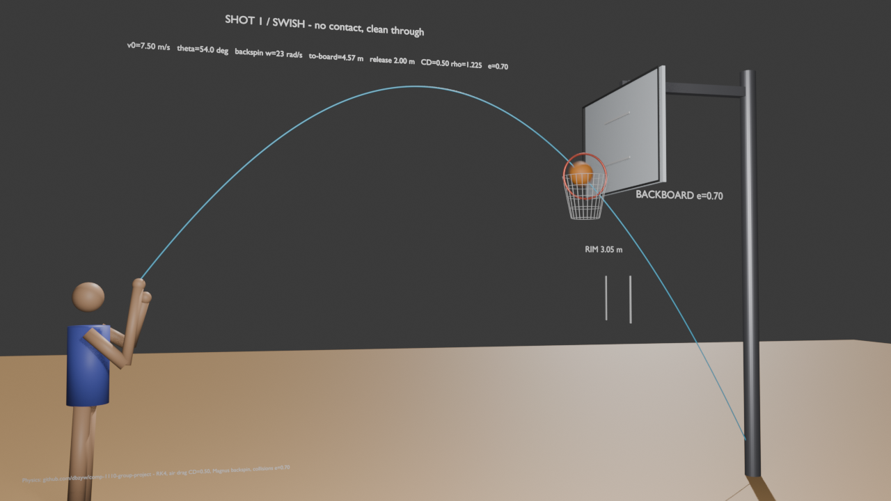
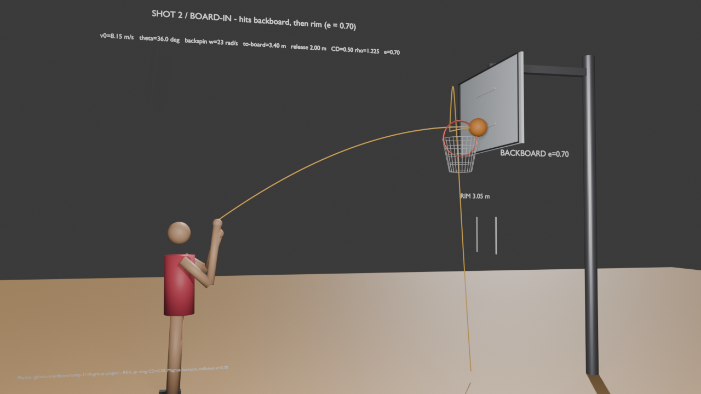
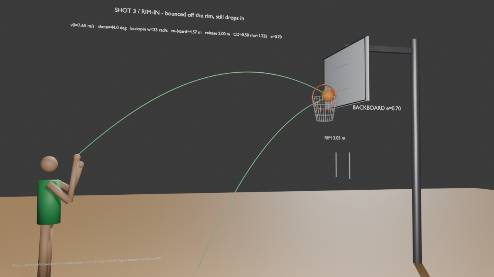

# 纯物理篮球投篮模拟

一个完全基于物理模型的篮球投篮仿真项目，不依赖机器学习或数据驱动训练。给定出手点、出手速度向量和后旋角速度，程序会使用四阶 Runge–Kutta（RK4）数值积分计算球的飞行轨迹，并在此过程中考虑：

- 重力
- 二次空气阻力
- 马格努斯升力（由后旋产生）
- 篮板与篮筐的刚性碰撞（含边缘/角落接触）

最终会判断这次投篮属于以下四种结果：

- `swish`：空心
- `rim-in`：碰筐后进
- `board-in`：打板后进
- `miss`：未进

这个项目同时包含交互式 2D 模拟器、参数扫描、可视化结果、单元测试和模型验证，适合用于研究不同出手角度和后旋对命中率的影响。

## 目录

1. [项目目标](#1-项目目标)
2. [快速开始（免安装版）](#2-快速开始免安装版)
3. [核心特性](#3-核心特性)
4. [两套模型常数不可混用](#4-两套模型常数不可混用)
5. [物理设定（3D 主流程）](#5-物理设定3d-主流程)
6. [文件结构](#6-文件结构)
7. [环境配置](#7-环境配置)
8. [推荐运行顺序](#8-推荐运行顺序)
9. [生成文件说明](#9-生成文件说明)
10. [团队协作建议](#10-团队协作建议)
11. [进一步说明](#11-进一步说明)

## 1. 项目目标

我们的目标不是训练一个预测模型，而是构建一个可解释、可重现、可验证的物理模拟框架，用来回答下面这个问题：

> 在给定出手几何、初速度和后旋的情况下，纯物理模型能否稳定复现真实投篮中出现的 swish / rim-in / board-in / miss 这四类结果？

项目的研究重点包括：

- 出手角度对飞行轨迹的影响
- 后旋对球的升力和落点的影响
- 空气阻力在罚球和三分球中的差异
- 篮板/篮筐碰撞对最终命中结果的影响
- 通过验证框架评估模拟与真实数据的偏差

## 2. 快速开始

运行 2D 交互式模拟器需要 Python 和项目依赖，详见 [SIMULATION_2D_GUIDE.md](SIMULATION_2D_GUIDE.md)。效果预览见 [SIMULATION_2D_DEMOS.md](SIMULATION_2D_DEMOS.md) 中的 6 个演示 GIF（空心、打板、弹筐、三分等典型场景）。

浏览器双击 [`basketball_interactive.html`](basketball_interactive.html) 可看 (角度 × 后旋) 扫描动画，无需 Python，但需要联网加载 plotly.js CDN。

## 3. 核心特性

- **交互式 2D 模拟器**（`basketball_shot_2d.py`）：滑块实时调节出手高度/角度/后旋/速度/距离，SHOOT 动画重放，SCAN WINDOW 一键搜索"必中速度区间"，内置罚球/三分预设——详见 [SIMULATION_2D_GUIDE.md](SIMULATION_2D_GUIDE.md)
- **三力模型**：重力 + 二次空气阻力（∝ |v|·v）+ 马格努斯升力（后旋，∝ ω × v）
- **RK4 数值积分**：支持单发模拟和批量向量化计算
- **碰撞检测**：篮板（平面-球碰撞）与篮筐（圆环-球碰撞），支持球心在矩形外时的篮板边缘/角落接触，支持批量检测与穿透位置校正——原理与改进方向见 [Collision.md](Collision.md)
- **恢复系数**：碰撞使用恢复系数反弹（法向 `e = 0.7`；3D 默认切向保留比例 1.0，2D 层切向乘 0.85）
- **命中结局细分**：3D 流程按碰撞历史输出 `swish` / `rim-in` / `board-in` / `miss`；2D 流程输出 `SWISH` / `BANK-IN` / `RATTLE-IN` 与各种 miss 描述，两套名称可通过 `collision.canonical_outcome_2d()` 归一化对接
- **Blender 3D 可视化**（`blender_3d/`）：用 Blender 5.x 把 3D 主流程的飞行（后旋马格努斯升力 + 二次空气阻力 + 碰撞恢复系数 e=0.7）烘焙成 60 fps 逐帧动画，场景含 2.00 m 人物、NBA 3.048 m 筐顶与标准尺寸篮板；产物 `out/shot3d.mp4`（1280×720）与 `basketball_shot3d.blend`，连续演出 swish / board-in / rim-in 三发；场景与渲染脚本见 § 5.4
- **交互式 HTML 轨迹浏览器**（`basketball_interactive.html`）：Plotly 生成的 (角度 × 后旋) 扫描动画（5 个角度 × 5 个后旋、固定 7.5 m/s 罚球出手），队友浏览器双击即可查看，无需 Python；`python make_interactive.py --offline` 可生成不依赖网络的完整内嵌版
- **命中概率热力图**：覆盖出手角度 × 后旋速率的参数扫描，输出命中概率面（3D 蒙特卡洛 + 2D "必中速度窗口"两套）
- **结局占比分解图**：`outcome_breakdown.png`，swish / rim-in / board-in 占比随参数的变化
- **轨迹对比**：比较真空瞄准 vs 真实飞行轨迹，并包含罚球与三分球对比
- **单元测试与自检**：`test_core.py` / `test_collision.py` / `test_experiment.py`，加上各脚本自带的无头自检（`--check`、`--selfcheck`、`python physics.py`、`python collision.py`）
- **模型验证**：报告一致率、Wilson 95% 置信区间、Cohen's kappa、MCC/precision/recall/F1 以及多分类混淆矩阵；对 `data_validation/valid_data.csv`（305 行）跑 `python validation.py data_validation/valid_data.csv` 的逐发预测与指标已权威记录在 [data_validation/model_validation_results.md](data_validation/model_validation_results.md)（当前 154/305 = 50.49%、κ = 0.012、模型预测 74 made / 231 miss、made 类 recall 24.84%——因输入是 `data_prep.py` 假设合成，**不是经验验证结论**）

## 4. ⚠️ 两套模型常数不可混用

仓库里存在**两套故意不同的物理常数**，结论不可互相搬运。合并后的 `physics.py` / `collision.py` 把两套常数并排放在同一文件里（3D 主名 / `*_2D` 后缀名），但**绝不要把一边的扫描结果直接拿到另一边下结论**：

| 常数 | 2D 模拟器 `basketball_shot_2d.py` | 3D 主流程 `physics.py` / `collision.py` |
|---|---|---|
| 球质量 | 0.60 kg | 0.62369 kg |
| 空气密度 ρ | 1.204 | 1.225 |
| 阻力系数 C_D | 0.47 | 0.50 |
| 马格努斯 | 固定 `C_L = 0.20`（力 ∝ ω×v） | `C_L0 = 1.00`，等价升力系数形式 |
| 恢复系数 | 法向 0.70 + 切向 0.85 | e = 0.70（默认切向保留比例 1.0） |
| 筐口净半径 | 0.2287 m（内径 45.7 cm） | 0.2286 m（NBA 内径 18 in） |
| 篮板-筐关系 | 板面 = 筐后沿 + 0.15 m | 筐心距板面 0.381 m（NBA 18 in rim + 6 in clearance） |

2D 模拟器常数冻结自课程 deck（详见 [SIMULATION_2D_PHYSICS.md](SIMULATION_2D_PHYSICS.md)），用于演示与交互；3D 主流程用于正式实验与验证。

## 5. 物理设定（3D 主流程）

### 5.1 坐标系

- 坐标系为右手系，单位为 SI
- `x` 方向从投手指向篮筐
- `y` 方向竖直向上
- `z` 方向为横向侧向

### 5.2 场地几何

- NBA 篮板正面位于 `x = 0`（宽 1.8288 m、高 1.0668 m，下沿 y = 2.8956 m）
- 投手位于 `-x` 侧
- NBA 篮筐开口中心位于 `(-0.381, 3.048, 0)`；钢管中心线在开口半径外再加钢管半径，且比筐顶低一个钢管半径
- 筐顶高度：`3.048 m`；净开口直径：`0.4572 m`（半径 `0.2286 m`）
- 钢管直径取 `0.018 m`（FIBA 16–20 mm 区间中点）；篮筐开口中心到篮板正面 `0.381 m`
- 篮球质量：`0.62369 kg`（22 oz）；半径：`0.11925 m`（29.5 in 周长换算）
- 反弹恢复系数：`e = 0.7`（篮板与篮筐可分别配置：`BACKBOARD_RESTITUTION` / `RIM_RESTITUTION`，当前默认均为 0.7）

### 5.3 后旋方向

纯后旋定义为：

```python
omega = (0, 0, +omega)
```

这样会产生一个向上的 Magnus 升力，因此后旋越大，球越容易"托起来"。

### 5.4 Blender 3D 可视化（`blender_3d/`）

The Python 3D physics simulation predicts both the trajectory and the final
outcome. A shot is classified as made when the ball crosses downward through
the hoop plane inside the scoring radius; otherwise it is a miss. Contact
history further distinguishes a make as `swish`, `rim-in`, or `board-in`.
Blender is the presentation layer: it visualises a trajectory and its
physics-computed outcome, but does not calculate either one.

For a new set of initial conditions, `simulation.simulate_shot()` returns the
predicted trajectory and outcome. For comparison against recorded shots, use
the validation pipeline with a labelled CSV (for example,
`python validation.py data_validation\valid_data_2D.csv`; the required
`actual_outcome` field is documented in
`data_validation/DATA_SPECIFICATION.md`). Blender can visualise trajectory
data, but the current build script only renders the three prepared made-shot
examples below; it does not automatically import arbitrary validation CSVs
or render misses.

To regenerate the prepared Blender examples from the repository root:

```powershell
python blender_3d\find_shots.py
blender -b -noaudio --python blender_3d\build_blender.py
```

The first command uses the 3D physics simulation to find example trajectories
and classify their outcomes, then writes `traj_*.csv` plus `shots.json`. The
second reads those files, builds and
saves `blender_3d\basketball_shot3d.blend`, and renders stills under
`blender_3d\out\`; it also renders `shot3d.mp4` when `ffmpeg` is available on
`PATH`. The animation reveals each trajectory alongside the ball and gives the
shooting arm a subtle follow-through. Score stills use the interpolated
hoop-plane crossing time. The scripts use the 3D model only, not the separate
2D simulator.
The Blender builder imports ball, rim, backboard, drag, and restitution values
from the 3D physics/collision modules; the generated `shots.json` also carries
the release height used by both the simulation and the scene labels/player.

三发 3D 投篮（全部由主流程判为 made，常数与几何完全沿用 § 5 的 3D 主流程，出手高度 2.00 m 对应场景中 2.00 m 人物；后旋统一采用 `data_validation/data_prep.py` 的默认值 14.137167 rad/s，即 2.25 RPS）：

| 发数 | 参数 | 碰撞序列 | 判定 |
|---|---|---|---|
| swish | 7.50 m/s @ 53°，距篮板 4.57 m | 无 | 穿篮偏移 r = 0.014 m |
| board-in | 7.80 m/s @ 38.5°，距篮板 3.40 m | backboard → rim | e = 0.70 反弹后进 |
| rim-in | 7.40 m/s @ 48°，距篮板 4.57 m | rim | 穿篮偏移 r = 0.063 m |

- `find_shots.py`（可从任意目录跑，内部把仓库根目录加入 `sys.path`，直接调用 3D `simulate_shot`；搜索与附近精炼使用 dt = 2 ms，最终轨迹使用 dt = 1 ms；默认后旋从 `data_validation.data_prep.DEFAULT_BACKSPIN_RAD_S` 读取）：扫参数选出上述三发，导出 `traj_*.csv`（`frame,x,y,z,vx,vy,vz`，60 fps 帧号列）与 `shots.json`
- `build_blender.py`（Blender 5.x 内嵌 Python，可无头跑 `blender -b -noaudio --python blender_3d/build_blender.py`）：读取 CSV 与 `shots.json`，按 60 fps 逐帧烘焙篮位置与后旋姿态关键帧（钱库坐标→Blender 映射 x→X, y→Z, z→−Y，自旋角度 = −ωt），建立人物 / 節板（带内外瞩梶线）/ 篮篘与篮网 / 筓平线标注，Eevee 渲某 1280×720 并用 ffmpeg 合成 `out/shot3d.mp4`（413 帧，段落 1–93 / 138–248 / 293–383，间隙 45 帧）
- 进殷后的篮下落为近似处理：从碰撞循环停止点继续纯籴 RK4 积分到篮心触地，不再模拟篮网与篮沿下方的二次碰撞

与 § 4 的两常数体系一致：本展示全部取自 3D 主流程常数，不得与 2D 层结果混用。

视频与静帧展示（均取自 `blender_3d/out/`，60 fps、1280×720，三发连投 swish → board-in → rim-in）：

[](blender_3d/out/shot3d.mp4)







> 视频链接在 GitHub 会内联播放；每发出手 / 中段 / 碰撞瞬间 / 判定日与落地帧的完整静帧见 `blender_3d/out/qc_*`。这些已渲染媒体需要在更新 `find_shots.py` 生成的新轨迹后重新运行 Blender 构建脚本，才会与上表的默认后旋一致。

## 6. 文件结构

| 文件 | 作用 |
|---|---|
| `basketball_shot_2d.py` | 交互式 2D 投篮模拟器（滑块 + 动画 + 速度窗口扫描）；`--check` 跑 6 个文档场景无头自检 |
| `physics.py` | 定义物理常数（含 `*_2D` 两套）、三力模型和 RK4 积分函数（3D 与 2D） |
| `collision.py` | 3D 篮板/篮筐碰撞检测（含边缘/角落、批量、多接触有限轮处理）与 2D 板面穿越/前后缘反弹几何，含归一化结局映射 |
| `simulation.py` | `simulate_shot`（3D 单发，碰撞循环 + CSV）、`simulate_2d`/`fit_segments_2d`/`readout_2d`（与交互器同源的库版 2D 引擎） |
| `experiment.py` | 参数扫描：`free` / `three` 生成 3D 数据、`2d` 生成 2D 必中速度窗口数据；直接运行默认四套全跑；`--selfcheck` 逐字节复现校验 |
| `plotting.py` | 生成 7 张 PNG（热力图、结局分解、轨迹对比、罚球 vs 三分阻力偏差）；`breakdown` / `selfcheck` 子命令 |
| `validation.py` | 验证流程、评估指标和占位数据生成；`--make-dummy [--correlated]`、`selfcheck` 模式 |
| `make_interactive.py` | 生成 Plotly 交互式轨迹浏览器 `basketball_interactive.html`；`--offline` / `--out` |
| `test_core.py` | 核心物理/碰撞/模拟的单元测试（无第三方依赖） |
| `test_collision.py` | 碰撞几何与速度响应的专项测试 |
| `test_experiment.py` | 扫描 CSV 输出与配置元数据的可复现性测试 |
| `data_validation/` | 第一阶段验证数据暂存区：`DATA_SPECIFICATION.md`（数据规范）、`extract.py`（SportVU 轨迹抽取）、`data_prep.py`（2D 出手参数合成器）、原始数据集 `basketball_shooting_dataset.csv`（300 行）、`valid_data_2D.csv`（300 行直线近似）与 `valid_data_3D.csv`（35 行暂定 3D 输入） |
| `Specifications/` | 计划书、规格说明与进度汇报（`.md` + 原版 `.pdf` / `.pptx`） |
| `SIMULATION_2D_GUIDE.md` | 2D 模拟器使用指南（滑块/按钮/开关/读数） |
| `SIMULATION_2D_PHYSICS.md` | 2D 模拟器物理模型与常数（含与 3D 流程的差异说明） |
| `Collision.md` | 碰撞模型的计算方法、测试与改进方向 |
| `requirements.txt` | Python 依赖列表 |
| `blender_3d/build_blender.py` | Blender 5.x 场景搭建 + 60 fps 逐帧烘焙 + 无头渲某脚本（只读 CSV/JSON，不 import 仓库模块） |
| `blender_3d/find_shots.py` | 扫选三发 made 结局并导出 `traj_*.csv` / `shots.json`（import 上层 `physics`/`collision`/`simulation`） |
| `blender_3d/basketball_shot3d.blend` | 完整 3D 场景（三发连投，413 帧 @ 60 fps，含已成关键帧） |
| `blender_3d/out/shot3d.mp4` | 渲某成品动画（1280×720，60 fps，约 6.9 s） |
| `blender_3d/out/qc_*.png` 与 `verify_*.png` | 各发出手 / 中段 / 碰撞瞬间 / 判分日静帧（1280×720） |
| `HANDOVER_GUIDE.md` | 交接说明与运行顺序 |
| `PROJECT_CONTEXT.md` | 给协作者/AI 助手的背景说明 |

## 7. 环境配置

要求 Python 3.10+。依赖见 [requirements.txt](requirements.txt)：

```bash
pip install -r requirements.txt
```

核心依赖通常只有：

- `numpy`
- `matplotlib`

如果还要生成交互式 HTML，需要额外安装 `plotly`：

```bash
pip install plotly
```

## 8. 推荐运行顺序

建议按下面顺序执行，这样最容易确认每一部分是否正常工作：

```bash
# 1) 单元测试：核心物理 + 碰撞几何 + 扫描输出
python test_core.py
python test_collision.py
python test_experiment.py

# 2) 物理引擎自检（3D 积分 + 2D 常数/退化输入，打印自检通过项）
python physics.py

# 3) 碰撞自检（4 组 3D 示例 + 5 组 2D 示例）
python collision.py

# 4) 单发罚球模拟：输出结果并生成 trajectory.csv
#    （同时跑 6 个 2D 文档场景并生成 trajectory_2d.csv）
python simulation.py

# 5) 参数扫描：直接运行默认跑全部四套（3D 角度×后旋、3D 三分、
#    2D 必中速度窗口 × 罚球/三分），或按需选择子命令：
python experiment.py          # 全部
python experiment.py free     # 仅 3D 罚球 -> data.csv
python experiment.py three    # 仅 3D 三分 -> data_three.csv
python experiment.py 2d       # 仅 2D 窗口 -> data_2d.csv / data_2d_three.csv

# 6) 生成图表：7 张 PNG 一次出全（热力图 + 结局分解 + 轨迹对比）
python plotting.py

# 7) 验证：先生成示例数据，再跑一致性验证（含置信区间与 kappa）
python validation.py --make-dummy
python validation.py
```

其他常用入口：

```bash
# 交互式 2D 模拟器（弹出 TkAgg 窗口）
python basketball_shot_2d.py

# 2D 模拟器无头自检（CI 用，不开窗口）
python basketball_shot_2d.py --check

# 各脚本自带的可复现自检（写入临时目录，不污染仓库数据）
python experiment.py --selfcheck
python plotting.py selfcheck
python validation.py selfcheck

# 3D 罚球大网格多进程扫描（默认单进程已够快，网格很大时才需要）
python experiment.py --mp

# 生成交互式 HTML 轨迹浏览器（需 plotly；--offline 出内嵌 plotly.js 的完整版）
python make_interactive.py
python make_interactive.py --offline --out basketball_interactive_offline.html
```

## 9. 生成文件说明

| 文件 | 生成方式 | 内容 |
|---|---|---|
| `trajectory.csv` | `python simulation.py` | 单发 3D 罚球轨迹，列为 `time, x, y, z, vx, vy, vz` |
| `trajectory_2d.csv` | `python simulation.py` | 2D 罚球基准场景（2.00 m / 51° / 14.137167 rad/s / 7.90 m/s / 4.60 m）的轨迹点 |
| `data.csv` | `python experiment.py`（或 `free`） | 3D 罚球扫描结果，列为 `angle, backspin, p_make, p_swish, p_rim_in, p_board_in` + 每行附带扫描配置元数据（距离、名义速度、随机种子、抖动 σ、网格范围等） |
| `data_three.csv` | `python experiment.py`（或 `three`） | 3D 三分球扫描结果，列结构同上 |
| `data_2d.csv` / `data_2d_three.csv` | `python experiment.py`（或 `2d`） | 2D 每格统计：`p_speed_made`、各结局占比、最宽"必中速度窗口" `band_lo/hi/width/mid`、中点精确结局 |
| `dummy_data.csv` | `python validation.py --make-dummy` | 验证用占位数据（`--correlated` 出自洽版，一致率应为 100%） |
| `make_probability.png` | `python plotting.py` | 罚球命中概率图 |
| `make_probability_three.png` | `python plotting.py` | 三分球命中概率图 |
| `make_probability_comparison.png` | `python plotting.py` | 罚球/三分球并排对比 |
| `outcome_breakdown.png` | `python plotting.py` | 进球子类（swish/rim-in/board-in）占比分解图 |
| `trajectory_comparison.png` | `python plotting.py` | 罚球轨迹比较 |
| `trajectory_comparison_three.png` | `python plotting.py` | 三分球轨迹比较 |
| `free_vs_three_drag.png` | `python plotting.py` | 罚球 vs 三分球空气阻力偏差图 |
| `basketball_interactive.html` | `python make_interactive.py` | 带滑块的交互式轨迹浏览器（CDN 版，需联网） |

`data_validation/` 目录将两类验证输入分开保存：`valid_data_2D.csv` 的 300 行由 `data_prep.py` 按直线、`release_z = v0z = 0` 的假设生成；`valid_data_3D.csv` 的 35 行来自 selected/filtered 初值，正 `x_m` 已取负，`z_m` 暂映射为高度、`y_m` 暂映射为侧向位置。3D 文件的标签、后旋、坐标轴、原点与速度单位尚未确认；两类数据均可被 `validation.py` 解析，但都不构成经验验证结论。字段规范与验收步骤见 [data_validation/DATA_SPECIFICATION.md](data_validation/DATA_SPECIFICATION.md)。

## 10. 团队协作建议

这个 README 适合给团队成员快速了解项目，用作项目入口文档。建议团队成员在协作时遵循以下习惯：

- 先看 [PROJECT_CONTEXT.md](PROJECT_CONTEXT.md) 了解项目背景和接口说明
- 再从 [HANDOVER_GUIDE.md](HANDOVER_GUIDE.md) 按顺序执行脚本
- 想快速上手玩模拟器：按 [SIMULATION_2D_GUIDE.md](SIMULATION_2D_GUIDE.md) 的步骤运行
- 改碰撞相关代码前，先读 [Collision.md](Collision.md) 和 `test_collision.py`，改完跑一遍测试
- 改任何链路的代码后，跑对应脚本的 `--check` / `--selfcheck`，再跑 `test_*.py`，确认逐位一致再提交
- 修改代码时优先参考各个 Python 文件中的 docstring 和函数说明
- 若要增加新实验或新数据集，先更新说明，再补充图表/验证结果

## 11. 进一步说明

- 相关交接说明： [HANDOVER_GUIDE.md](HANDOVER_GUIDE.md)
- AI/协作者上下文说明： [PROJECT_CONTEXT.md](PROJECT_CONTEXT.md)
- 详细项目计划与技术背景： [Specifications/](Specifications/)
- 2D 模拟器： [SIMULATION_2D_GUIDE.md](SIMULATION_2D_GUIDE.md) / [SIMULATION_2D_PHYSICS.md](SIMULATION_2D_PHYSICS.md)
- 碰撞模型细节： [Collision.md](Collision.md)
- 验证数据规范： [data_validation/DATA_SPECIFICATION.md](data_validation/DATA_SPECIFICATION.md)
- 验证逐发预测与指标明细（可复现）： [data_validation/model_validation_results.md](data_validation/model_validation_results.md)
- 报告草稿： [Report_Draft.md](Report_Draft.md)，汇报大纲： [Presentation_Outline.md](Presentation_Outline.md)

如果你和队友都在同一个项目里协作，这个 README 可以作为"项目总入口"，帮助快速定位脚本、数据和结果文件。
