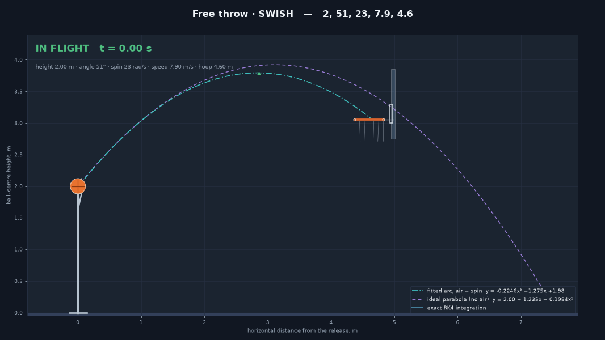
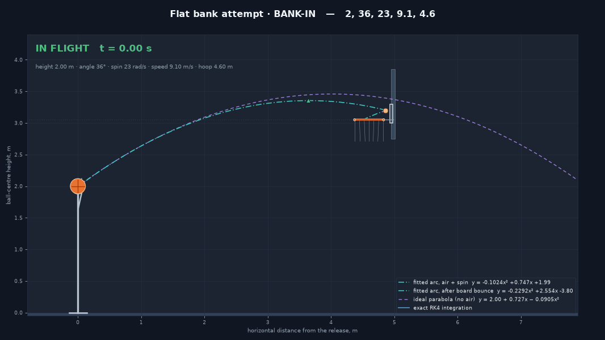
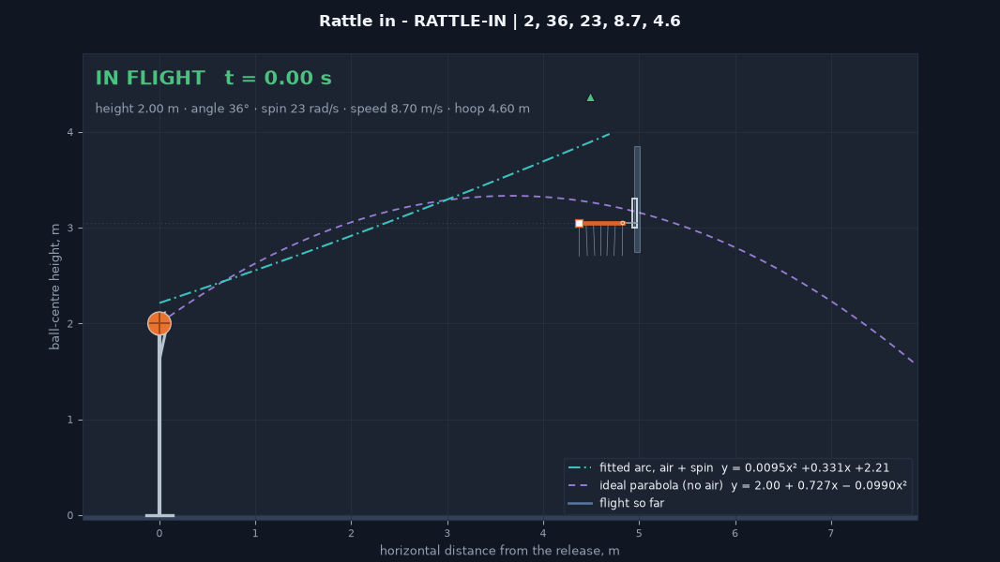
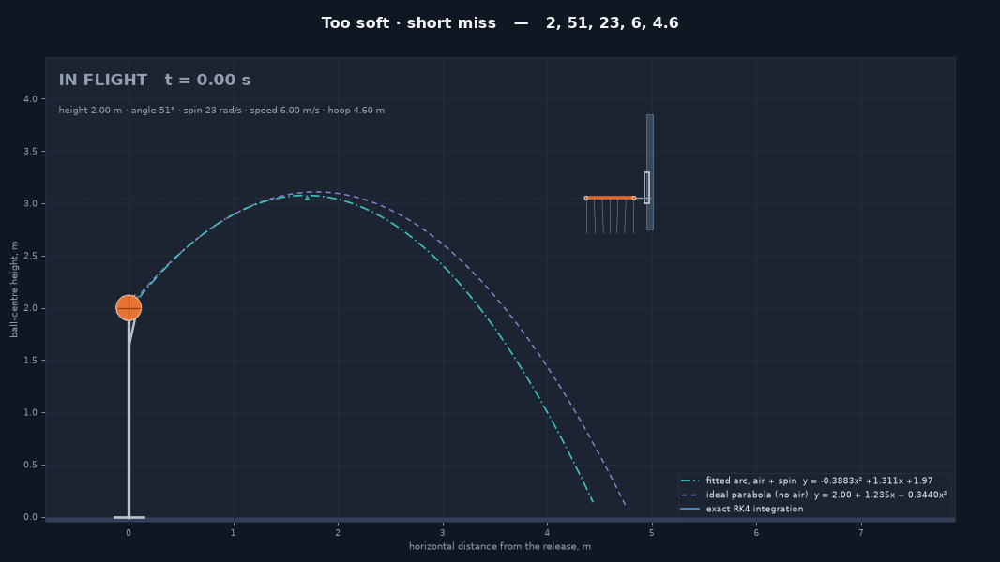
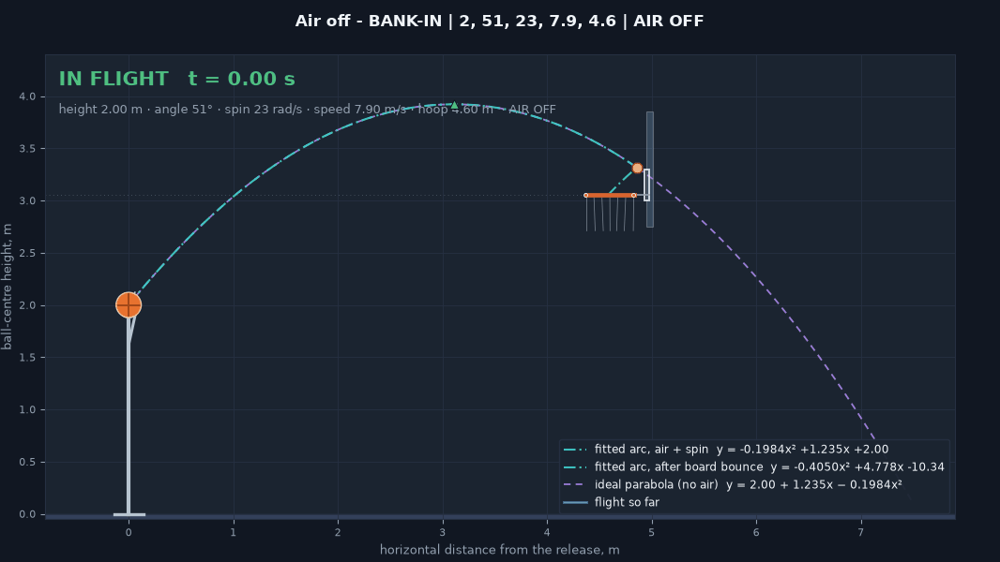
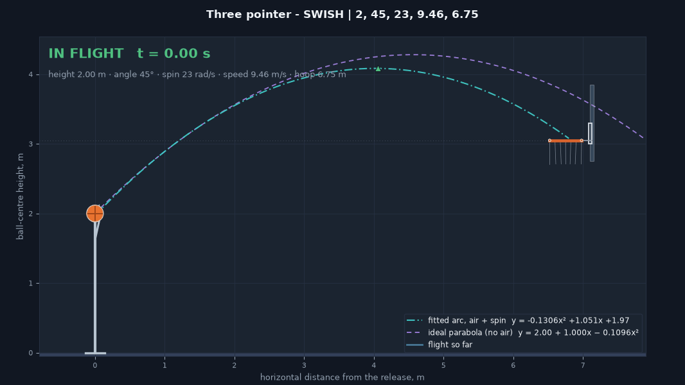

# 2D 模拟器演示 GIF（demo_gifs/）

> 这是 `SIMULATION_2D_DEMOS.md` 的改进版（2026-10-21），原版文件保留在同目录。
> 主要变更：为每个 GIF 补了可直接点击/渲染的路径与画面、修正 04 与 06 两处
> 与代码不符的描述、写明三套复现入口（`--check` / `simulation.py` / `experiment.py --selfcheck`）。

以下 GIF 由 `basketball_shot_2d.py` 的同一套渲染管线 headless 导出
（`simulate` → `init_scene` → `update_scene` 逐帧渲染，20 fps），展示几种典型参数与结局。
参数与代码里的 `DEMO_SCENES`、`python simulation.py` 的 2D 场景表、以及
`SIMULATION_2D_GUIDE.md` §7 的 `--check` 自检完全对应。画面元素说明见
[SIMULATION_2D_GUIDE.md](SIMULATION_2D_GUIDE.md)，物理模型见
[SIMULATION_2D_PHYSICS.md](SIMULATION_2D_PHYSICS.md)。

| GIF | 参数（高度 m / 角度° / 后旋 rad/s / 速度 m/s / 距离 m） | 结局 | 看点 |
|---|---|---|---|
| [`01_free_throw_swish.gif`](demo_gifs/01_free_throw_swish.gif) | 2.00 / 51 / 23 / 7.90 / 4.60 | **SWISH** | 罚球基准情形：真实弧线（青）比真空抛物线（紫）平缓，空心入筐 |
| [`02_bank_shot.gif`](demo_gifs/02_bank_shot.gif) | 2.00 / 36 / 23 / 9.10 / 4.60 | **BANK-IN** | 低平打板：球撞板反弹后落进筐，青色弧线在碰撞点分出第二段 |
| [`03_rattle_in.gif`](demo_gifs/03_rattle_in.gif) | 2.00 / 36 / 23 / 8.70 / 4.60 | **RATTLE-IN** | 弹筐：球先后磕筐沿反弹（白方框标记）最终滚进 |
| [`04_short_miss.gif`](demo_gifs/04_short_miss.gif) | 2.00 / 51 / 23 / 6.00 / 4.60 | miss（well short） | 力量太小：`x` 从未到达 4.60 m 的筐面平面（`plane_h` 为空），未碰任何东西直接落地 |
| [`05_air_off.gif`](demo_gifs/05_air_off.gif) | 2.00 / 51 / 23 / 7.90 / 4.60（AIR OFF） | **BANK-IN** | 同 01 的参数但关掉空气：没有阻力/升力时同样的出手变成打板进——直观展示空气对命中与否的影响 |
| [`06_three_pointer.gif`](demo_gifs/06_three_pointer.gif) | 2.00 / 45 / 23 / 9.46 / 6.75 | **SWISH** | 三分线（6.75 m）：需要明显更大的出手速度（9.46 vs 7.90 m/s），最优仰角从 51° 降到 45°——与 3D 扫描"三分最优角下移约 7°"的结论方向一致 |

## 预览（GitHub / VS Code 内直接渲染）

| 01 SWISH | 02 BANK-IN | 03 RATTLE-IN |
|---|---|---|
|  |  |  |
| **04 well short** | **05 air-off BANK-IN** | **06 three SWISH** |
|  |  |  |

复现方法：运行 `python basketball_shot_2d.py`，把上表参数拖进滑块（或按 FREE THROW /
THREE POINT 预设）即可在交互界面看到同样的轨迹。无头逐场景校验（不开窗口、退出码可进 CI）：

```bash
python basketball_shot_2d.py --check     # 6/6 场景 + 退化输入拒绝
python simulation.py                     # 库版 simulate_2d 再复现同样 6 场景 -> trajectory_2d.csv
python experiment.py --selfcheck         # 2D 窗口扫描 CSV 逐字节可复现
```
